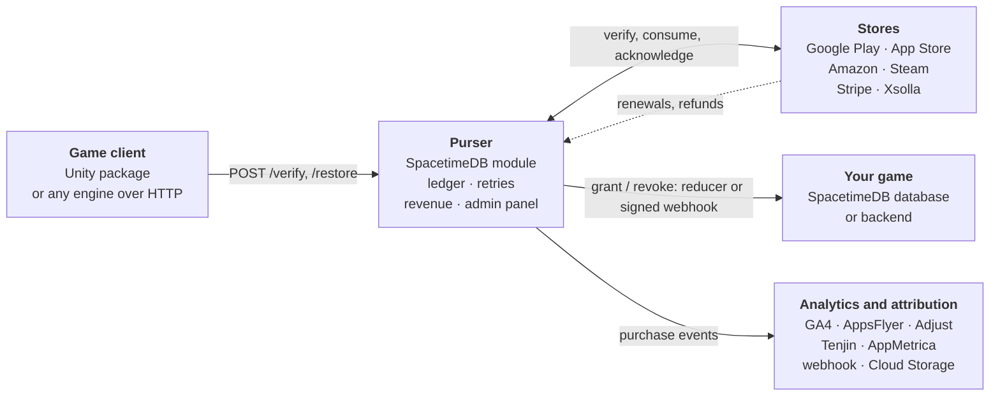
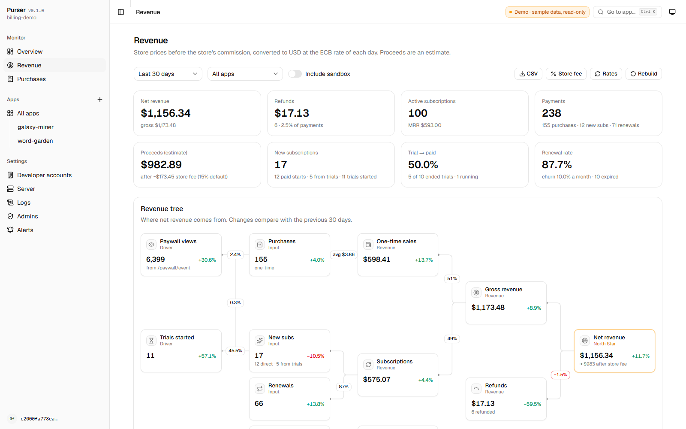
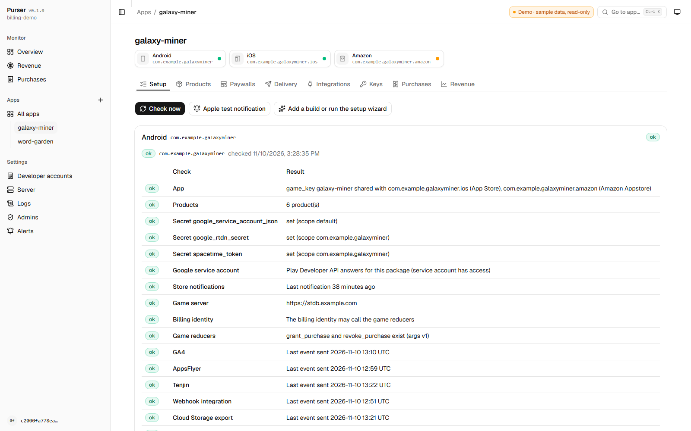

# Purser

[](https://github.com/yevhenii-sir/purser/actions/workflows/ci.yml)
[](https://yevhenii-sir.github.io/purser/)
[](LICENSE)
[](https://spacetimedb.com)

**In-app purchases for games on SpacetimeDB: live on maincloud in seconds, or self-hosted.** Purser is an open-source alternative to Adapty and RevenueCat: purchases from Google Play, the App Store, Amazon, Steam and the web are verified by your own SpacetimeDB module, rewards are delivered straight into the game, and the admin panel shows the setup status and the revenue.

**[Documentation](https://yevhenii-sir.github.io/purser/)** · **[Admin panel demo](https://yevhenii-sir.github.io/purser/demo/)** (read-only, made-up data, no sign-in) · **[Latest release](https://github.com/yevhenii-sir/purser/releases/latest)**



## Quick start

Have a [SpacetimeDB](https://spacetimedb.com) account? There is nothing else to host: no server, no database, no containers. Install the [SpacetimeDB CLI](https://spacetimedb.com/install) 2.14.1 or newer, sign in with `spacetime login`, then, outside a SpacetimeDB project folder:

```bash
curl -LO https://github.com/yevhenii-sir/purser/releases/latest/download/purser.wasm
spacetime publish --server maincloud --bin-path purser.wasm <your-billing-db>
```

1. Open `https://maincloud.spacetimedb.com/v1/database/<your-billing-db>/route/admin` and sign in with your token (`spacetime login show --token`).
2. Apps → **Add an app**: package / bundle ids, how rewards reach the game, store keys ([store setup](docs/store-setup.md)), products. The last step checks everything and shows the URLs to paste into Play Console and App Store Connect.
3. Unity: add the package, create the config (Tools → Purser → Create Config) and press **Paste config from admin panel**:
   ```json
   "com.yevhenii.purser": "https://github.com/yevhenii-sir/purser.git?path=/unity/com.yevhenii.purser"
   ```
   Other engines use plain HTTP + JSON ([OpenAPI spec](docs/openapi.yaml)); the game grants rewards in its own reducers, a webhook or on the client ([game integration](docs/game-integration.md)).

Prefer your own hardware? [deploy/docker](deploy/docker/README.md) runs SpacetimeDB with automatic HTTPS. **Upgrading** is publishing the new `purser.wasm` to the same database; never use `--delete-data`, it deletes the purchase ledger. Step-by-step guide: [Getting started](docs/getting-started.md).

<picture>
  <source media="(prefers-color-scheme: dark)" srcset="docs/images/admin-revenue-dark.png">
  
</picture>

<picture>
  <source media="(prefers-color-scheme: dark)" srcset="docs/images/admin-setup-dark.png">
  
</picture>

## Features

- **Stores**: Google Play, App Store, Amazon Appstore, Steam and web payments (Stripe, Xsolla). Server-side verification, consume / acknowledge, restore, entitlements shared between all builds of a game.
- **A ledger with retries**: rewards are delivered exactly once even when the game server is down; refunds, renewals and expirations come from store notifications. Optionally answers App Store refund requests with consumption data.
- **Admin panel** served by the module: an *Add an app* wizard, a setup check with fix hints, products with Google Play and App Store import, players, purchases, integrations, keys, logs.
- **Revenue**: net revenue, refunds, subscriptions and MRR in USD (ECB rates), by app, product, country and currency.
- **Paywalls and A/B tests** as remote config, and **alerts** to Telegram, Slack, Discord or a webhook when deliveries fail or keys are rejected.
- **Integrations**: GA4, AppsFlyer, Adjust, Tenjin and AppMetrica server-to-server events, a signed JSON webhook, raw event export to Google Cloud Storage (BigQuery).
- **Unity package** on Unity IAP 5 with VContainer / Zenject adapters and Apple Ads attribution.
- **Configuration as code** (`server/seed.py`: upload, export, a setup wizard) and an **[MCP server](docs/mcp.md)** to ask Claude about revenue, players and the setup.

## Compared with Adapty and RevenueCat

Adapty and RevenueCat are hosted services with many more features; this project covers the core purchase backend and keeps it in your hands.

| | Purser | Adapty / RevenueCat |
|---|---|---|
| Hosting | Your SpacetimeDB database (maincloud or self-hosted) | Vendor cloud, managed for you |
| Cost | Free (MIT); your hosting costs | Free tier, then revenue share / paid tiers |
| Purchase data | In your database | On the vendor's servers, available through their dashboards, API and exports |
| Source code | Server and SDK are open source | Client SDKs are open source, the backend is not |
| Stores | Google Play, App Store, Amazon Appstore, Steam, web payments (Stripe, Xsolla) | Google Play, App Store and more (for example web payments) |
| Client SDKs | Unity; any engine over HTTP + JSON | Native iOS / Android, cross-platform frameworks, Unity and more |
| Reward delivery | Reducer call into your SpacetimeDB game, signed webhook, or on the client | Webhooks, client SDK |
| Paywalls, A/B tests, cohorts | Remote-config paywalls and A/B tests (no visual builder), payer cohorts | Visual paywall builder, A/B tests, cohorts |
| Integrations | GA4, AppsFlyer, Adjust, Tenjin, AppMetrica, webhook, Cloud Storage | Many analytics, attribution and marketing integrations |
| Operations | You run and upgrade it | The vendor runs it |

## Documentation

| | |
|---|---|
| [docs/store-setup.md](docs/store-setup.md) | Google Play service account and RTDN, App Store keys and notifications |
| [docs/game-integration.md](docs/game-integration.md) | Delivery contract (reducers, webhook), games without a backend, other engines |
| [docs/analytics.md](docs/analytics.md) | What the revenue dashboard counts, currencies |
| [docs/apple-offers.md](docs/apple-offers.md) | App Store promotional offers signed by the server, offer codes, win-back offers |
| [docs/alerts.md](docs/alerts.md) | Telegram / Slack / Discord / webhook alerts about failing deliveries, rejected keys, silent notifications |
| [docs/paywalls.md](docs/paywalls.md) | Paywalls, remote config and A/B tests: placements, assignment, results |
| [docs/self-hosting.md](docs/self-hosting.md) | Running on your own SpacetimeDB server behind a proxy |
| [deploy/docker/](deploy/docker/README.md) | Docker Compose: SpacetimeDB, module publishing, Caddy with automatic HTTPS |
| [docs/openapi.yaml](docs/openapi.yaml) | OpenAPI 3.1 description of the public HTTP API |
| [docs/mcp.md](docs/mcp.md) | MCP server: ask Claude about revenue, players, purchases and the setup (`server/mcp_server.py`) |
| [docs/migrating-from-adapty.md](docs/migrating-from-adapty.md) | Running next to Adapty, legacy reducers, moving the ledger between servers |
| [server/README.md](server/README.md) | Server reference: tables, secrets, HTTP API, admin calls, `seed.py` |
| [unity/com.yevhenii.purser/README.md](unity/com.yevhenii.purser/README.md) | Unity package |

## Building from source

```bash
cd server
cargo test -p purser-core
cargo test -p purser
cargo build -p purser --target wasm32-unknown-unknown --release
spacetime publish --bin-path target/wasm32-unknown-unknown/release/purser.wasm <your-billing-db>
```

See [CONTRIBUTING.md](CONTRIBUTING.md). Security issues: [SECURITY.md](SECURITY.md). License: [MIT](LICENSE).
