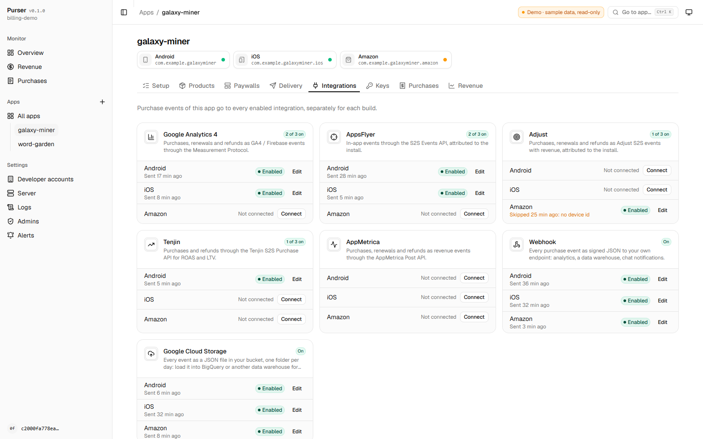
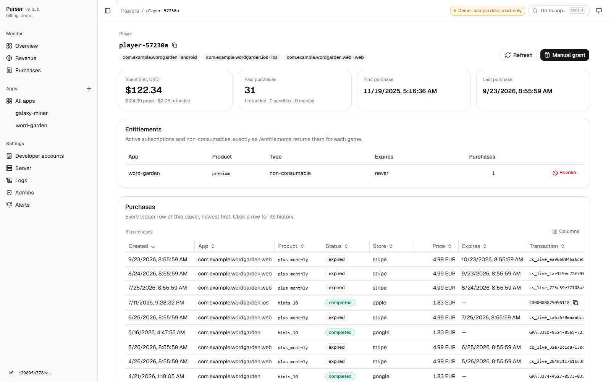

# Purser

[](https://github.com/yevhenii-sir/purser/actions/workflows/ci.yml)
[](https://yevhenii-sir.github.io/purser/)
[](LICENSE)
[](https://spacetimedb.com)

**In-app purchases for games on SpacetimeDB: live on maincloud in seconds, or self-hosted.** Purser is in-app purchase billing for mobile games, an open-source alternative to Adapty and RevenueCat. Google Play and App Store purchases are verified by your own SpacetimeDB module, rewards are delivered straight into the game, and the admin panel shows the setup status and the revenue.

**Documentation:** [yevhenii-sir.github.io/purser](https://yevhenii-sir.github.io/purser/) (the same pages as [docs/](docs/)). **[Admin panel demo](https://yevhenii-sir.github.io/purser/demo/)**: read-only, with made-up apps and purchases, no sign-in.

## Deploy in seconds

Have a [SpacetimeDB](https://spacetimedb.com) account? Purser runs on SpacetimeDB **maincloud** with nothing else to set up: no server, no database, no containers. Sign in once with `spacetime login`, then:

```bash
curl -LO https://github.com/yevhenii-sir/purser/releases/latest/download/purser.wasm
spacetime publish --server maincloud --bin-path purser.wasm <your-billing-db>
```

Open `https://maincloud.spacetimedb.com/v1/database/<your-billing-db>/route/admin`, sign in with your token (`spacetime login show --token`) and add your first app. Prefer your own hardware? The same module runs on a self-hosted SpacetimeDB ([Docker setup](deploy/docker/README.md)).

## Why

- **Yours, hosted either way.** One SpacetimeDB module: published to maincloud with one command, or on your own server ([Docker setup](deploy/docker/README.md)). No third-party service sits between the stores and your game.
- **No revenue share.** MIT-licensed and free; you pay only for your own hosting.
- **Your data.** The purchase ledger, players' entitlements and revenue live in your database. Export them to your warehouse whenever you want.
- **Open source.** Read, audit and change how purchases are verified and rewards are delivered.

```
┌──────────── client (Unity / GameMaker / …) ────────────┐
│  Unity: unity/com.yevhenii.purser (Unity IAP 5)        │
└──────────────┬─────────────────────────────────────────┘
               │ POST /verify, /restore, /entitlements
               ▼
┌──────── server/ — SpacetimeDB module (Rust) ───────────┐       Google Play Developer API
│  transaction ledger, consume/acknowledge, retries,     │◀────▶ App Store Server API
│  store notifications (RTDN, ASSN v2), revenue, GA4     │◀───── RTDN / Server Notifications
└──────────────┬─────────────────────────────────────────┘
               │ grant / revoke: SpacetimeDB reducer or HMAC-signed webhook
               ▼
          game database / backend
```

<picture>
  <source media="(prefers-color-scheme: dark)" srcset="docs/images/admin-revenue-dark.png">
  
</picture>

<picture>
  <source media="(prefers-color-scheme: dark)" srcset="docs/images/admin-setup-dark.png">
  
</picture>

<picture>
  <source media="(prefers-color-scheme: dark)" srcset="docs/images/admin-integrations-dark.png">
  
</picture>

<picture>
  <source media="(prefers-color-scheme: dark)" srcset="docs/images/admin-player-dark.png">
  
</picture>

## Features

- **Server-side verification** of Google Play and App Store purchases, consume / acknowledge, restore, entitlements shared between the Android and iOS apps of a game.
- **A ledger with retries**: rewards are delivered exactly once even when the game server is down; refunds, renewals and expirations come from store notifications.
- **Admin panel** served by the module and organized by app (one product with its Android and iOS builds): an *Add an app* wizard, a setup check with fix hints for every store and delivery setting, products with Google Play import, integrations, keys, purchases, revenue, logs.
- **Revenue dashboard**: net revenue, refunds, subscriptions and MRR in USD (ECB rates), by app, product and currency.
- **Integrations**: GA4, AppsFlyer, Adjust, Tenjin and AppMetrica server-to-server events, a signed JSON webhook, raw event export to Google Cloud Storage (BigQuery), and Apple Ads campaign attribution in the Unity SDK.
- **Unity package** on Unity IAP 5 with VContainer / Zenject adapters; any other engine works over plain HTTP + JSON ([OpenAPI spec](docs/openapi.yaml)).
- **Runs anywhere SpacetimeDB runs**: maincloud, or your own server with [Docker Compose and automatic HTTPS](deploy/docker/README.md).

## Compared with Adapty and RevenueCat

Adapty and RevenueCat are hosted services with many more features; this project covers the core purchase backend and keeps it in your hands.

| | Purser | Adapty / RevenueCat |
|---|---|---|
| Hosting | Your SpacetimeDB database (maincloud or self-hosted) | Vendor cloud, managed for you |
| Cost | Free (MIT); your hosting costs | Free tier, then revenue share / paid tiers |
| Purchase data | In your database | On the vendor's servers, available through their dashboards, API and exports |
| Source code | Server and SDK are open source | Client SDKs are open source, the backend is not |
| Stores | Google Play, App Store, Amazon Appstore, Steam, web payments (Stripe, Xsolla) | Google Play, App Store and more (for example web payments) |
| Client SDKs | Unity; any engine over HTTP + JSON | Native iOS / Android, cross-platform frameworks, Unity and more |
| Reward delivery | Reducer call into your SpacetimeDB game, signed webhook, or on the client | Webhooks, client SDK |
| Paywalls, A/B tests, cohorts | Remote-config paywalls and A/B tests (no visual builder), payer cohorts | Visual paywall builder, A/B tests, cohorts |
| Integrations | GA4, AppsFlyer, Adjust, Tenjin, AppMetrica, webhook, Cloud Storage | Many analytics, attribution and marketing integrations |
| Operations | You run and upgrade it | The vendor runs it |

## Quick start

1. Install the [SpacetimeDB CLI](https://spacetimedb.com/install) 2.14.1 or newer and sign in: `spacetime login`.
2. Download the module from the [latest release](https://github.com/yevhenii-sir/purser/releases/latest) and publish it (outside a SpacetimeDB project folder):
   ```bash
   curl -LO https://github.com/yevhenii-sir/purser/releases/latest/download/purser.wasm
   spacetime publish --server maincloud --bin-path purser.wasm <your-billing-db>
   ```
3. Open the admin panel at `https://maincloud.spacetimedb.com/v1/database/<your-billing-db>/route/admin` and sign in with your token (`spacetime login show --token`). If you created the database in the SpacetimeDB dashboard before publishing, the panel first asks you to **finish the installation**: one click registers you as the owner admin and starts the worker (an update does not run the module's `init`).
4. Apps → **Add an app**: enter the package / bundle ids, choose how rewards reach the app, upload the store keys ([docs/store-setup.md](docs/store-setup.md)), import or enter products. The last step checks everything and shows the URLs to paste into Play Console and App Store Connect. The app's **Setup** tab repeats the check until it is green.
5. Unity: add the package to `Packages/manifest.json`, create the config (Tools → Purser → Create Config) and press **Paste config from admin panel**:
   ```json
   "com.yevhenii.purser": "https://github.com/yevhenii-sir/purser.git?path=/unity/com.yevhenii.purser"
   ```

Prefer your own server? [deploy/docker](deploy/docker/README.md) runs SpacetimeDB, publishes the module and adds an HTTPS proxy with `docker compose`.

Your game grants rewards in its own SpacetimeDB reducers or webhook, or on the client if it has no backend: see [docs/game-integration.md](docs/game-integration.md).

**Upgrading:** publish the new `purser.wasm` to the same database name. Never use `--delete-data`: it deletes the purchase ledger.

## Documentation

| | |
|---|---|
| [docs/store-setup.md](docs/store-setup.md) | Google Play service account and RTDN, App Store keys and notifications |
| [docs/game-integration.md](docs/game-integration.md) | Delivery contract (reducers, webhook), games without a backend, other engines |
| [docs/analytics.md](docs/analytics.md) | What the revenue dashboard counts, currencies |
| [docs/apple-offers.md](docs/apple-offers.md) | App Store promotional offers signed by the server, offer codes, win-back offers |
| [docs/alerts.md](docs/alerts.md) | Telegram / Slack / Discord / webhook alerts about failing deliveries, rejected keys, silent notifications |
| [docs/paywalls.md](docs/paywalls.md) | Paywalls, remote config and A/B tests: placements, assignment, results |
| [docs/self-hosting.md](docs/self-hosting.md) | Running on your own SpacetimeDB server behind a proxy |
| [deploy/docker/](deploy/docker/README.md) | Docker Compose: SpacetimeDB, module publishing, Caddy with automatic HTTPS |
| [docs/openapi.yaml](docs/openapi.yaml) | OpenAPI 3.1 description of the public HTTP API |
| [docs/mcp.md](docs/mcp.md) | MCP server: ask Claude about revenue, players, purchases and the setup (`server/mcp_server.py`) |
| [docs/migrating-from-adapty.md](docs/migrating-from-adapty.md) | Running next to Adapty, legacy reducers, moving the ledger between servers |
| [server/README.md](server/README.md) | Server reference: tables, secrets, HTTP API, admin calls, `seed.py` |
| [unity/com.yevhenii.purser/README.md](unity/com.yevhenii.purser/README.md) | Unity package |

## Configuration as code

Instead of the admin panel, the configuration can live in JSON files (`server/seed.example`) and be uploaded with `server/seed.py`, which also runs the setup check:

```bash
cd server
cp spacetime.example.json spacetime.json   # set your database name
cp -r seed.example secrets                 # fill in apps, products and keys; secrets/ is git-ignored
python seed.py --check
```

`python seed.py --init` walks through a first setup from the terminal instead, and `python seed.py --export backup` writes an existing database's configuration (without secret values) to files in the same format.

Secrets never live in the repository: they are stored in the module's private tables and can be bound to an app, to a developer account or set as the default. The admin panel never reads them back.

## Building from source

```bash
cd server
cargo test -p purser-core
cargo test -p purser
cargo build -p purser --target wasm32-unknown-unknown --release
spacetime publish --bin-path target/wasm32-unknown-unknown/release/purser.wasm <your-billing-db>
```

See [CONTRIBUTING.md](CONTRIBUTING.md). Security issues: [SECURITY.md](SECURITY.md). License: [MIT](LICENSE).
