# How it works

Sequence diagrams of the main flows: who calls whom, in what order, and what the ledger row goes through. The details
of each step are on the pages linked under each diagram.

Names used below: **client** is the game on the player's device (the Unity package or any [SDK](sdks.md)), **Purser**
is the billing database, **game server** is your game's SpacetimeDB database or backend that receives rewards, and
the **ledger** is Purser's table of purchases (one row per store transaction).

## A purchase in Google Play or the App Store

The client buys through the store, then asks Purser to check the purchase. Purser looks it up in the store's API, writes
the ledger row first and only then calls anything else, so a failure at any later step is retried, never lost.

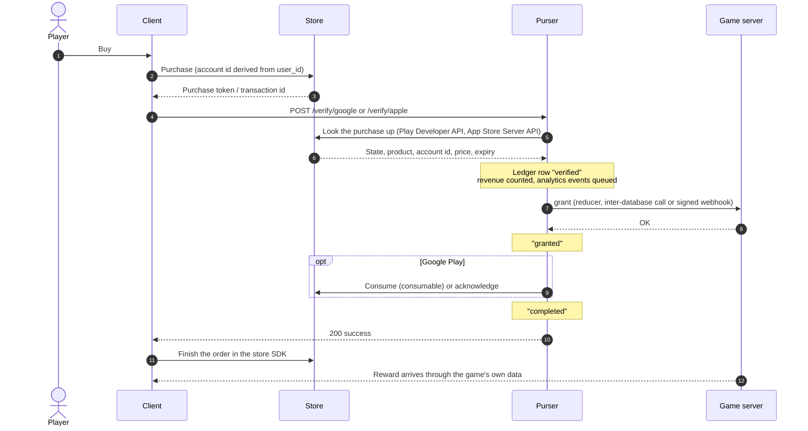

- A consumable is credited only to the player whose id the purchase carries (`obfuscatedAccountId` / `appAccountToken`);
  a purchase consumed outside Purser is refused with `ERR_CONSUMED_ELSEWHERE`.
- If delivery does not finish within the request's time budget, `/verify` answers `202 pending` and the worker
  carries on (see [Delivery and retries](#delivery-and-retries)). The client finishes the order anyway: the ledger has it.
- On `error` or without network the client does **not** finish the order and asks again later.
- Amazon, Huawei, Samsung and Meta Quest work the same way with their own APIs.

More: [game integration](game-integration.md), [store setup](store-setup.md).

## Games without a backend (`delivery = none`)

Purser checks the purchase and keeps the ledger, entitlements and analytics; the client grants the reward itself.
The order below makes sure a crash at any point never loses a reward.

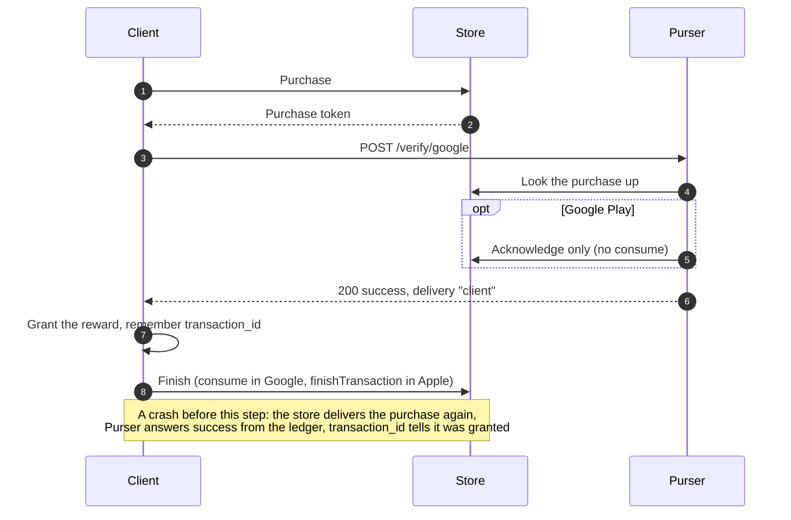

More: [games without a backend](game-integration.md#games-without-a-backend-delivery-none).

## Delivery and retries

Every outside call of a purchase (deliver to the game, consume in the store) is a step of its ledger row. The request
tries it at once; when it fails, the minute worker retries with backoff.

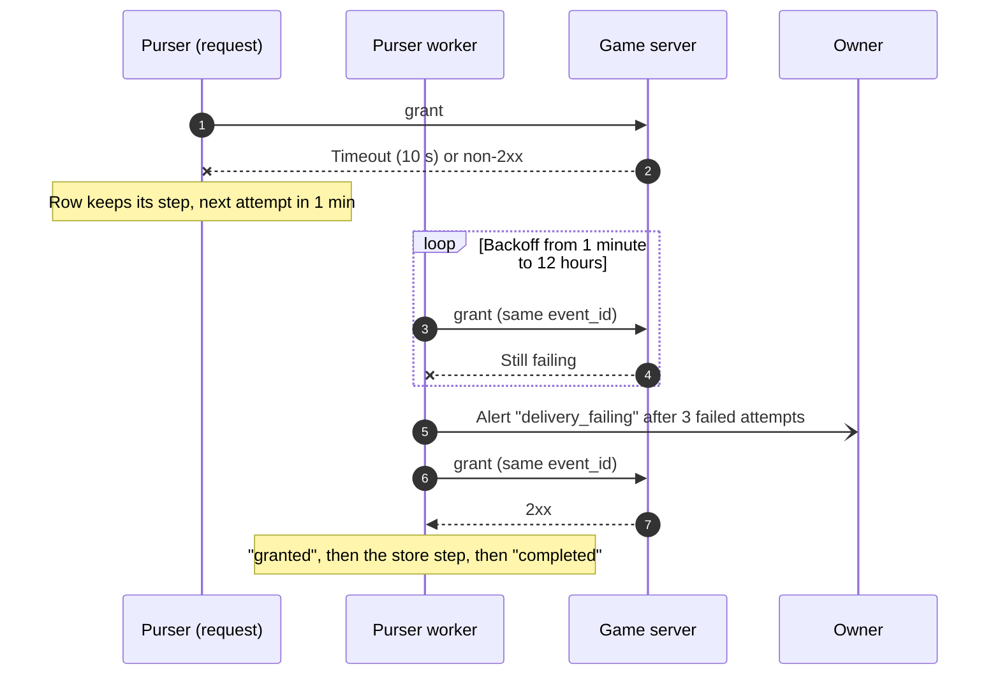

- The game applies each `event_id` once: a call it applied but answered too late arrives again.
- With `spacetimedb_idc` delivery the call is written to an outbox in the same transaction and SpacetimeDB delivers it
  once; the ledger row waits for the game reducer's answer instead of retrying.
- A step that only a change of the setup can fix (a missing key, a host that is not allowed, a deleted build) is
  **blocked**: it waits until that setup is saved, or 6 hours.
- Events of one purchase go one at a time: a `revoke` waits for the `grant` in flight.

More: [retries and ordering](game-integration.md#delivery-events), [owner alerts](alerts.md).

## Renewals, refunds and expirations

Stores tell Purser about changes with notifications. A notification only says *what to look up again*: Purser asks the
store for the current state and moves the ledger from that, so a forged or replayed notification changes nothing.

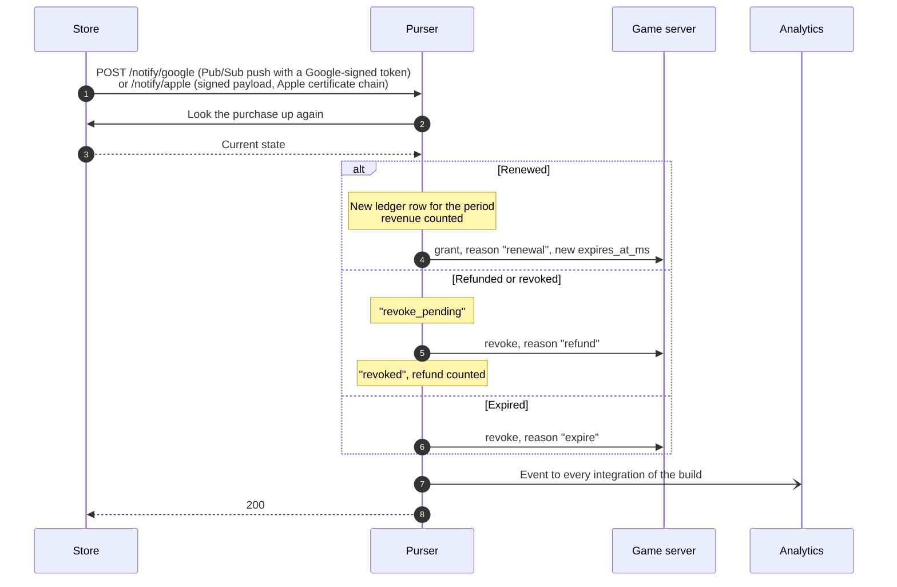

- Subscriptions are also re-checked by the worker on a schedule, so a renewal or expiration whose notification never
  arrived is still seen (Steam and Meta Quest have no notifications at all).
- Refunds that no notification reported are found by a sweep every 6 hours (Google Play voided purchases, App Store
  notification history).

More: [store setup](store-setup.md), [analytics](analytics.md).

## Restore on another player

Non-consumables and subscriptions belong to the store account. When a player restores them under a new `user_id`
(reinstall, second profile), the purchase moves: the previous owner loses it first.

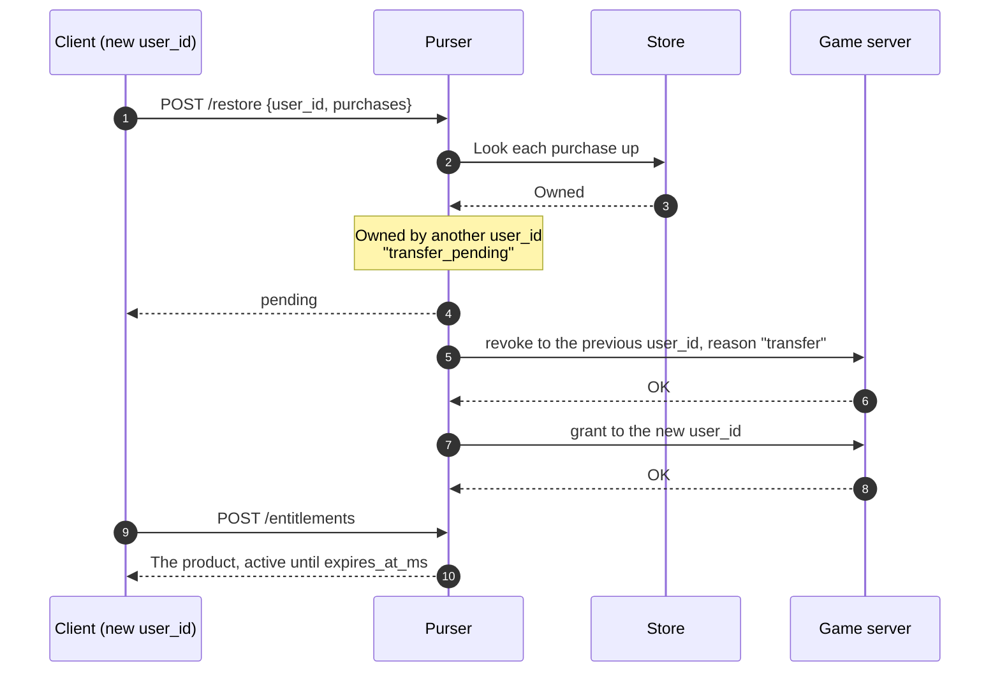

An app can limit transfers (at most one per N days, at most N per purchase, or never); a refused restore answers
`ERR_TRANSFER_LIMIT`. Consumables never move (`ERR_TX_CLAIMED`).

More: [transfer](game-integration.md#delivery-events).

## Web checkout with Stripe

There is no client receipt on the web: Purser creates the Checkout Session, and Stripe's webhook is the source of
truth. Xsolla works the same way with its pay station.

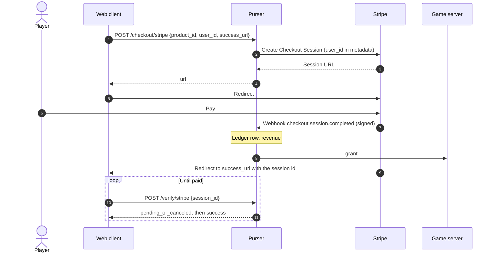

Renewals, cancellations, refunds and disputes arrive as further webhooks. `/manage/stripe` opens Stripe's customer
portal for the player's subscriptions.

More: [Stripe](store-setup.md#stripe), [Xsolla](store-setup.md#xsolla).

## Steam

Steam purchases are driven by the server: Purser opens the order, the Steam overlay asks the player, and Purser
finalizes it.

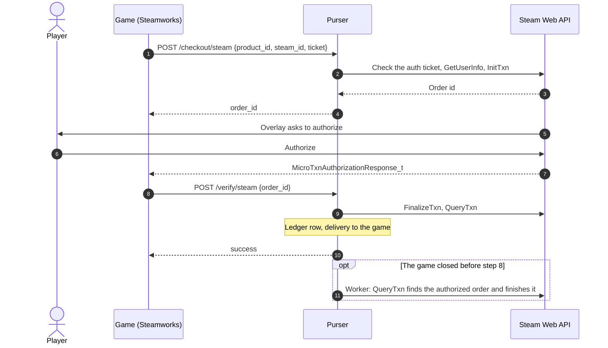

More: [Steam](store-setup.md#steam).

## Telegram Stars

Purser creates invoice links of the game's bot and is the bot's webhook.

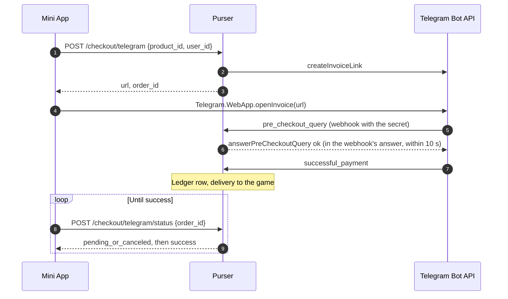

A `refunded_payment` update revokes the purchase.

More: [Telegram Stars](store-setup.md#telegram-stars).

## Analytics and attribution events

Every ledger transition queues one event per integration of the build in the same transaction. A sender works through
the queue outside the request, so a slow analytics service never slows a purchase.

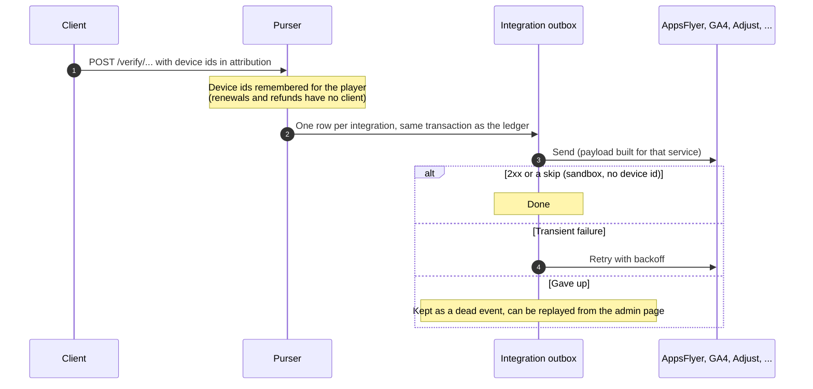

More: [integrations](https://github.com/yevhenii-sir/purser/blob/main/server/README.md), [BigQuery export](bigquery.md).

## Paywalls and A/B tests

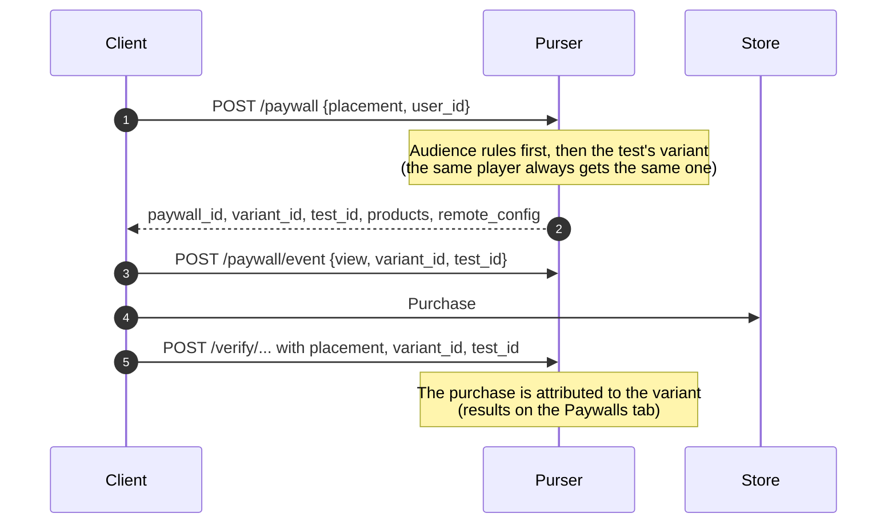

More: [paywalls and A/B tests](paywalls.md).

## Virtual currency

A product can give currency (`gems:100`). Purser keeps the balances; the client or the game's backend spends them.

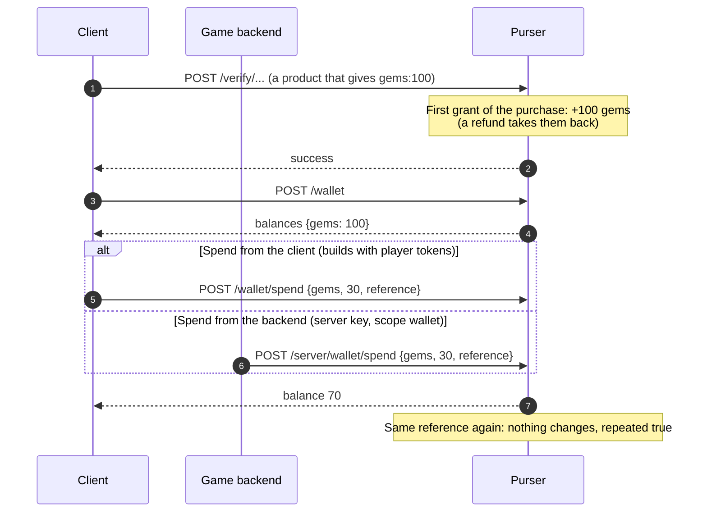

More: [virtual currency](wallet.md).
