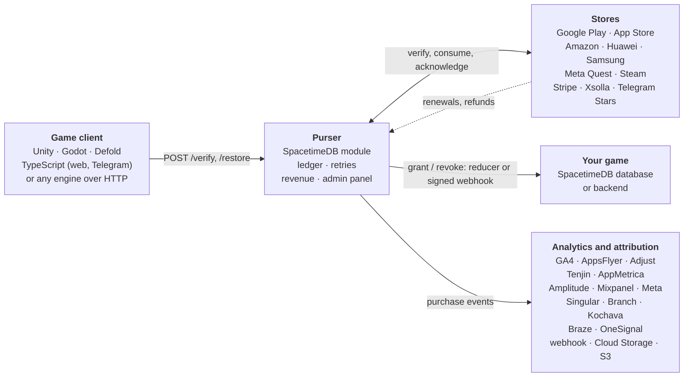

# Purser

Purser is in-app purchase billing for mobile games and apps, built on [SpacetimeDB](https://spacetimedb.com). It is an open-source alternative to Adapty and RevenueCat. Run it on maincloud, where it is live in seconds, or host it yourself.

- **Your own SpacetimeDB module verifies purchases.** It handles Google Play, the App Store, Amazon, Huawei, Samsung, Meta Quest, Steam, the web and Telegram.
- **Rewards go straight into the game.**
- **The admin panel** shows the setup status and the revenue.

[Deploy to maincloud](getting-started.md#on-maincloud){ .md-button .md-button--primary } [Self-host with Docker](self-hosting.md){ .md-button } [Admin panel demo](https://yevhenii-sir.github.io/purser/demo/){ .md-button }

!!! warning "Status: before 1.0"
    Purser has not run a live game yet. A minor release may still need a publish with `--delete-data`. See [versions and upgrades](releases.md) for what is promised, how often releases come out and how far each store has been tried.

## How it fits together

The game client sends each purchase to Purser. Purser checks it with the store, delivers the reward to your game, and reports the event to your analytics tools. Stores tell Purser about renewals and refunds.

For each flow step by step, see [how it works](flows.md).

## Features

- **Stores**: Google Play, App Store, Amazon Appstore, Huawei AppGallery, Samsung Galaxy Store, Meta Quest (Horizon Store), Steam, web payments (Stripe, Xsolla) and Telegram Stars. Purser verifies on the server, consumes or acknowledges, and restores purchases. All builds of a game share entitlements.
- **A ledger with retries**: every reward reaches the game, even when the game server is down. Purser retries until the reward is applied. Each event carries an `event_id`, so the game applies it once. Refunds, renewals and expirations come from store notifications. Purser can also answer App Store refund requests with consumption data.
- **Admin panel**, served by the module. It has an *Add an app* wizard, a setup check with fix hints, products with Google Play and App Store import, players, purchases, integrations, keys and logs.
- **Revenue** ([analytics](analytics.md)): net revenue, refunds, subscriptions and MRR in USD (ECB rates, market rates for the other currencies). Break it down by app, product, country and currency.
- **[Paywalls and A/B tests](paywalls.md)** as remote config.
- **[Alerts](alerts.md)** to Telegram, Slack, Discord or a webhook when deliveries fail or keys are rejected.
- **Integrations**:
    - server-to-server events to GA4, AppsFlyer, Adjust, Tenjin, AppMetrica, Amplitude, Mixpanel, Meta Conversions API, Singular, Branch, Kochava, Braze and OneSignal;
    - a signed JSON webhook;
    - raw event export to Google Cloud Storage (BigQuery) and S3-compatible storage (AWS S3, Cloudflare R2, MinIO).
- **Unity package** on Unity IAP 5, with VContainer / Zenject adapters and Apple Ads attribution.
- **[SDKs for other engines](sdks.md)**: TypeScript (web games, Cocos Creator, PlayCanvas, Telegram Mini Apps), Godot 4 and Defold.
- **Configuration as code** with `server/seed.py`: upload, export and a setup wizard.
- **[MCP server](mcp.md)** to ask Claude about revenue, players and the setup.

## Compared with Adapty and RevenueCat

Adapty and RevenueCat are hosted services with many more features. Purser covers the core purchase backend and keeps it in your hands.

| | Purser | Adapty / RevenueCat |
|---|---|---|
| Hosting | Your SpacetimeDB database (maincloud or self-hosted) | Vendor cloud, managed for you |
| Cost | Free (MIT); your hosting costs | Free tier, then revenue share / paid tiers |
| Purchase data | In your database | On the vendor's servers, available through their dashboards, API and exports |
| Source code | Server and SDK are open source | Client SDKs are open source, the backend is not |
| Stores | Google Play, App Store, Amazon Appstore, Huawei AppGallery, Samsung Galaxy Store, Meta Quest, Steam, web payments (Stripe, Xsolla), Telegram Stars | Google Play, App Store and more (for example web payments) |
| Client SDKs | Unity, TypeScript (web, Telegram), Godot, Defold; any engine over HTTP + JSON | Native iOS / Android, cross-platform frameworks, Unity and more |
| Reward delivery | Reducer call into your SpacetimeDB game, signed webhook, or on the client | Webhooks, client SDK |
| Paywalls, A/B tests, cohorts | Remote-config paywalls and A/B tests (no visual builder), payer cohorts | Visual paywall builder, A/B tests, cohorts |
| Integrations | GA4, AppsFlyer, Adjust, Tenjin, AppMetrica, Amplitude, Mixpanel, Meta, Singular, Branch, Kochava, Braze, OneSignal, webhook, Cloud Storage, S3 | Many analytics, attribution and marketing integrations |
| Operations | You run and upgrade it | The vendor runs it |

## Where to go next

New to Purser? Start with [Getting started](getting-started.md).

| | |
|---|---|
| [Getting started](getting-started.md) | Publish the module, open the admin panel, add an app, connect Unity |
| [Store setup](store-setup.md) | Google Play service account and RTDN, App Store keys and notifications |
| [Game integration](game-integration.md) | Delivery contract (reducers, webhook), games without a backend, other engines |
| [Self-hosting](self-hosting.md) | Your own SpacetimeDB server: Docker Compose, proxy allowlist, admin access |
| [API reference](api.md) | The public HTTP API (OpenAPI 3.1) |
| [MCP server](mcp.md) | Ask Claude (or any MCP client) about revenue, players, purchases and the setup |
| [Moving to another server](moving-servers.md) | A stable address of your own, what knows the server's address, copying the database |
| [Migrating from Adapty](migrating-from-adapty.md) | Running next to Adapty |
| [Migrating from RevenueCat](migrating-from-revenuecat.md) | Importing RevenueCat's history, switching clients |
| [Troubleshooting](troubleshooting.md) | Every error code, and what to do |
