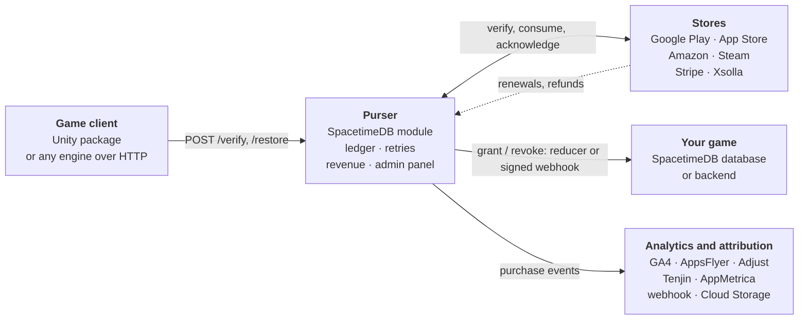

# Purser

In-app purchase billing for mobile games and apps on [SpacetimeDB](https://spacetimedb.com), live on maincloud in seconds or self-hosted: an open-source alternative to Adapty and RevenueCat. Purchases from Google Play, the App Store, Amazon, Steam and the web are verified by your own SpacetimeDB module, rewards are delivered straight into the game, and the admin panel shows the setup status and the revenue.

[Deploy to maincloud](getting-started.md#on-maincloud){ .md-button .md-button--primary } [Self-host with Docker](self-hosting.md){ .md-button } [Admin panel demo](https://yevhenii-sir.github.io/purser/demo/){ .md-button }

## Features

- **Stores**: Google Play, App Store, Amazon Appstore, Steam and web payments (Stripe, Xsolla). Server-side verification, consume / acknowledge, restore, entitlements shared between all builds of a game.
- **A ledger with retries**: rewards are delivered exactly once even when the game server is down; refunds, renewals and expirations come from store notifications. Optionally answers App Store refund requests with consumption data.
- **Admin panel** served by the module: an *Add an app* wizard, a setup check with fix hints, products with Google Play and App Store import, players, purchases, integrations, keys, logs.
- **Revenue** ([analytics](analytics.md)): net revenue, refunds, subscriptions and MRR in USD (ECB rates), by app, product, country and currency.
- **[Paywalls and A/B tests](paywalls.md)** as remote config, and **[alerts](alerts.md)** to Telegram, Slack, Discord or a webhook when deliveries fail or keys are rejected.
- **Integrations**: GA4, AppsFlyer, Adjust, Tenjin and AppMetrica server-to-server events, a signed JSON webhook, raw event export to Google Cloud Storage (BigQuery).
- **Unity package** on Unity IAP 5 with VContainer / Zenject adapters and Apple Ads attribution.
- **Configuration as code** (`server/seed.py`: upload, export, a setup wizard) and an **[MCP server](mcp.md)** to ask Claude about revenue, players and the setup.

## Compared with Adapty and RevenueCat

Adapty and RevenueCat are hosted services with many more features; this project covers the core purchase backend and keeps it in your hands.

| | Purser | Adapty / RevenueCat |
|---|---|---|
| Hosting | Your SpacetimeDB database (maincloud or self-hosted) | Vendor cloud, managed for you |
| Cost | Free (MIT); your hosting costs | Free tier, then revenue share / paid tiers |
| Purchase data | In your database | On the vendor's servers, available through their dashboards, API and exports |
| Source code | Server and SDK are open source | Client SDKs are open source, the backend is not |
| Stores | Google Play, App Store, Amazon Appstore, Steam, web payments (Stripe, Xsolla) | Google Play, App Store and more (for example web payments) |
| Client SDKs | Unity; any engine over HTTP + JSON | Native iOS / Android, cross-platform frameworks, Unity and more |
| Reward delivery | Reducer call into your SpacetimeDB game, signed webhook, or on the client | Webhooks, client SDK |
| Paywalls, A/B tests, cohorts | Remote-config paywalls and A/B tests (no visual builder), payer cohorts | Visual paywall builder, A/B tests, cohorts |
| Integrations | GA4, AppsFlyer, Adjust, Tenjin, AppMetrica, webhook, Cloud Storage | Many analytics, attribution and marketing integrations |
| Operations | You run and upgrade it | The vendor runs it |

## Where to go next

| | |
|---|---|
| [Getting started](getting-started.md) | Publish the module, open the admin panel, add an app, connect Unity |
| [Store setup](store-setup.md) | Google Play service account and RTDN, App Store keys and notifications |
| [Game integration](game-integration.md) | Delivery contract (reducers, webhook), games without a backend, other engines |
| [Self-hosting](self-hosting.md) | Your own SpacetimeDB server: Docker Compose, proxy allowlist, admin access |
| [API reference](api.md) | The public HTTP API (OpenAPI 3.1) |
| [MCP server](mcp.md) | Ask Claude (or any MCP client) about revenue, players, purchases and the setup |
| [Migrating from Adapty](migrating-from-adapty.md) | Running next to Adapty, legacy reducers, moving the ledger |
