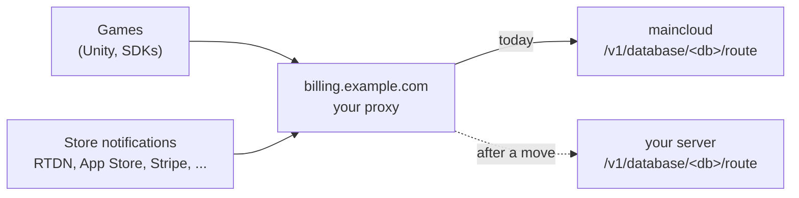

# Moving to another server

Moving from maincloud to your own server (or between any two SpacetimeDB servers) has two parts. The **data** moves with
`migrate.py`: purchases, settings, keys, admins and server keys, so the new server answers `/entitlements` at once. The
**address** is the hard part: game builds already in players' hands, every store's notification settings and a few
identities know the old one. Plan for the address before the first release, and a move never needs a new game build.

## A stable address of your own

Give clients and stores an address you control, like `https://billing.example.com`, and put a small proxy behind it
that forwards to the database's route base. Moving is then changing where the proxy points: nothing in the games or
the store consoles changes.



1. **The proxy** maps `https://billing.example.com/<path>` to `https://<host>/v1/database/<your-billing-db>/route/<path>`
   and passes the method, the body and every header unchanged: store notifications are checked by signatures over the
   raw body (App Store, Amazon, Stripe, Xsolla) or by headers (Telegram's secret token, player tokens). It must not
   cache or rewrite bodies. Caddy in front of maincloud:

    ```caddy
    billing.example.com {
        request_body {
            max_size 1MB
        }
        rewrite * /v1/database/<your-billing-db>/route{uri}
        reverse_proxy https://maincloud.spacetimedb.com {
            header_up Host maincloud.spacetimedb.com
        }
    }
    ```

    On your own server the same block ends with `reverse_proxy localhost:3000` instead (see [self-hosting](self-hosting.md));
    the proxy then exposes only the routes of one database, a narrower public surface than the allowlist. A Cloudflare
    Worker does the same:

    ```js
    export default {
      fetch(request) {
        const url = new URL(request.url)
        url.hostname = "maincloud.spacetimedb.com"
        url.pathname = "/v1/database/<your-billing-db>/route" + url.pathname
        return fetch(new Request(url, request))
      },
    }
    ```

2. **The clients** use it as their server address: `serverBaseUrl` of the Unity config, `baseUrl` of the TypeScript
   SDK, `base_url` of the Godot and Defold SDKs: `https://billing.example.com`.
3. **The server** knows it: Settings → Server → **Public address** = `https://billing.example.com`. The setup check,
   the store setup buttons and the Add an app wizard then show every notification URL with it, so the store consoles
   get the stable address too.
4. **The admin page** stays at the server's own address (`https://<host>/v1/database/<db>/route/admin`): it also calls
   the database's `/call` and `/sql`, which the proxy does not forward.

Check it before a release: `https://billing.example.com/healthz` answers like the server's own `/healthz`, and the
setup check of every build shows notification URLs on `billing.example.com`.

## Everything that knows the server's address

Without a stable address each of these has to be changed when the server moves; with one, only the last four.

| What | Where it is set | Note |
|---|---|---|
| Game clients | `serverBaseUrl` (Unity), `baseUrl` / `base_url` (SDKs) | Builds already published keep the old address until players update. |
| Google Play notifications | Pub/Sub push subscription of every build (its endpoint has the build's `secret`) | `setup_google.py` / Setup tab → Set up Google Cloud updates them. |
| App Store notifications | App Store Connect → the app → App Store Server Notifications, production and sandbox | Setup tab → Set up (Team key) sets both. |
| Amazon Appstore | Developer Console → Real-Time Notifications endpoint | The SNS subscription is confirmed again by the new server. |
| Huawei, Samsung | AppGallery Connect server notification URL; Seller Portal ISN URL of each item | |
| Stripe, Xsolla | Stripe webhook endpoint of every build; Xsolla project webhooks | Setup tab → Set up creates or repairs the Stripe endpoint. |
| Telegram Stars | The bot's webhook | Setup tab → Set the bot webhook. |
| Public address | Settings → Server → Public address | The setup check builds every URL above from it. |
| Admin sign-in | Redirect URI of the SpacetimeAuth (or other provider's) client | The admin page's own address: add the new one. |
| `spacetimedb_idc` delivery | The game database's allowlist of the billing identity | A new database has a new identity, and inter-database calls work only on the same server: a game that stays on the old server switches to `spacetimedb` delivery. |
| Admins with tokens | Tokens made by the old server ("Generate a token") | Another server may not accept them: give those admins new tokens, or invite them by email (sign-in through a provider works on any server). |
| The owner | The identity that published the new database | `migrate.py` keeps the new owner an admin. |

Store keys, the delivery `spacetime_token`, webhook secrets, player token and response signing keys and server keys are
copied with the database: games and backends keep working with them.

## Moving the database

`migrate.py --switch` does the whole move, as the owner of both databases:

```bash
python migrate.py --from maincloud --from-db <your-billing-db> --to myserver --to-db new-billing --dry-run
python migrate.py --from maincloud --from-db <your-billing-db> --to myserver --to-db new-billing --switch
```

Before it: publish the same Purser version on the new server and allow its delivery hosts there (Settings → Server).
The dry run backs up the old database and prints what would be written. `--switch` then:

1. **Pauses the old server.** Every client, server-key and store route answers `503` with `Retry-After: 60` and the code
   `ERR_MOVING`; its worker, deliveries, integration events, alerts and store product creation wait. Nothing is lost:
   the Unity package and the SDKs do not finish a purchase on `503` and send it again, and stores send their
   notifications again. Nothing is done twice: the old server starts no new work while the copy is taken.
2. **Copies the database** (`backup.py` backup and restore; every copied table of the new database is replaced). If the
   copy fails, the old server is resumed and nothing moved.
3. **Marks the new database as moved in.** Its Server page shows, per build, whether purchases and store notifications
   reach it yet, and what else still points at the old server (provider sign-in, inter-database delivery, admins with
   tokens). The pause the copy carries over is dropped there.
4. **Forwards the old server to the new one.** Every route is sent on with its body and headers (signatures, player
   tokens and server keys still check out) to the new server's route base, `--to-url` (default
   `<the --to server>/v1/database/<to-db>/route`; with a stable address, the address itself), and the answer comes
   back as it is. Before forwarding, the old server checks that the new one answers `/healthz` with the same version.

Then point the stable address at the new server, or, without one, change everything in the table above: until then
forwarding serves the games and stores that still call the old address. The old server's Server page counts what still
reaches it per route and build over the last 14 days: when nothing arrives any more, delete the old database. A request
that comes back already forwarded is refused (`508`): a new server pointing back at the old one cannot loop.

The steps can also be taken by hand: Settings → Server → **Moving to another server** (the owner: Pause, Forward, End
the move), `admin_set_move(mode, target)` and `admin_mark_moved_in(from)`. Without `--switch`, `migrate.py` only copies:
purchases the old server records after the copy stay there.

`/healthz` of a moving server answers `200` with `status` `moving` and `moving`: `paused` or `forwarding`, so a
monitor does not take the paused worker for a stopped one.
